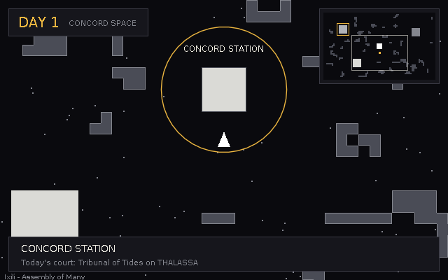
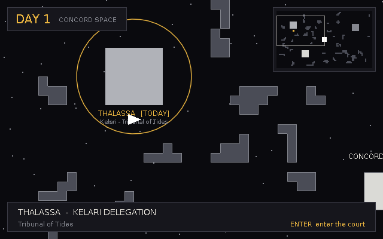
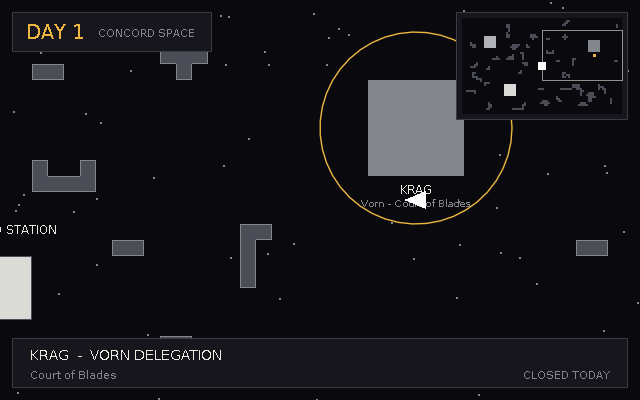
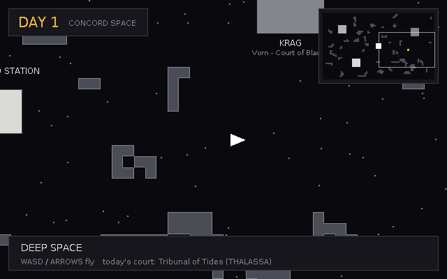
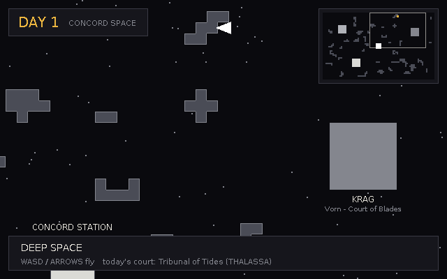
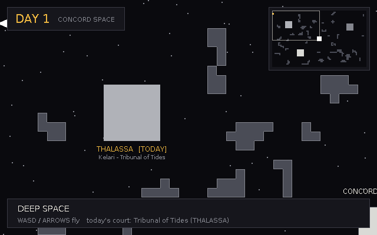
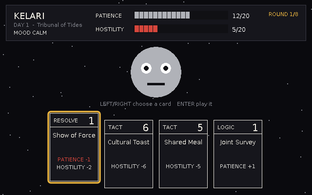

# Diplomacy Is In Space

Deckbuilder de diplomacia espacial hecho en [LÖVE](https://love2d.org) 11.5.

Eres el único operador de una estación que recibe una cumbre con razas alienígenas. Tu juegas **cartas de negociación** para manejar la **paciencia** y la **hostilidad** de cada delegado y evitar una guerra espacial. Cada día llega una raza distinta y tu mazo mejora entre rondas.

```sh
love .                    # menú principal -> PLAY
love . map                # directo al mapa
```

---

# Entrega 3 — Escena de mapa y exploración

Esta entrega agrega el mapa al ciclo del día y, con él, aparece lo visual que faltaba: el fondo de estrellas, los planetas y el retrato del delegado en la corte. Sigue en la paleta de grises con un acento ámbar; todo son formas planas hasta que haya assets.

## El ciclo del día

```
Estación  →  Briefing  →  MAPA  →  Corte  →  Estación, día N+1
(entrenas)   (cartas)     vuelas al planeta   defiendes tu caso
                          de la delegación    con tu colección
```

## Descripción

El mapa es **el sistema Concord**: el operador pilota un transbordador diplomático entre la estación y los mundos natales de cada delegación. Cada planeta es la sede del sistema judicial de su raza (los Kelari tienen el *Tribunal of Tides*, los Vorn la *Court of Blades*, los Ixili la *Assembly of Many*), así que viajar es ir al tribunal donde se negocia. Solo el planeta de la delegación del día está abierto; los demás dicen `CLOSED TODAY`.

## Diseño del mapa

El mapa es una cuadrícula de tiles escrita como texto: 80 × 48 celdas de 16 px (1280 × 768 px) en [`src/data/map.lua`](src/data/map.lua) (`.` espacio libre, `#` asteroide; los asteroides son grupos de celdas de formas irregulares). Es más grande que la pantalla (640 × 400), así que **la cámara sigue a la nave** y hay un minimapa para ubicarse. La estación (4×4 celdas) y los planetas (6×6) son bloques de celdas sólidas pintados encima. [`TileGrid`](src/world/TileGrid.lua) guarda el terreno de cada celda. Los tiles son formas planas hasta que haya arte; no hay autotiling todavía.

| Punto de interés | Dónde | Qué es |
|---|---|---|
| **Concord Station** | centro | Punto de partida; el HUD recuerda cuál es la corte de hoy |
| **Thalassa** (Kelari) | arriba a la izquierda | Tribunal of Tides (abierto el día 1) |
| **Krag** (Vorn) | arriba a la derecha | Court of Blades (día 2) |
| **Hexa** (Ixili) | abajo a la izquierda | Assembly of Many (día 3) |

Hay 46 grupos de asteroides repartidos por el mapa, y la nave pasa entre ellos por pasillos angostos. Cada planeta lleva su nombre, raza y tribunal; el de la delegación de hoy se marca `[TODAY]`.

| Inicio, junto a la estación | Thalassa (planeta del día, abierto) | Krag (cerrado hoy) |
|---|---|---|
|  |  |  |

| La cámara sigue a la nave (el minimapa muestra la vista actual) |
|---|
|  |

## Implementación

### Setup → Update → Render

- **Setup**: [`MapScene`](src/scenes/MapScene.lua) crea una sola entidad `tilemap` (la cuadrícula, no una entidad por celda), una entidad por planeta/estación (`position`, `poi`) y la nave (`position`, `moveIntent`, `velocity`, `collider`, `ship`) en un punto libre junto a la estación, más los resources `map` (velocidad, lugar cercano) y `camera` (esquina superior izquierda de la vista).
- **Update** (el orden ES el orden del frame):

  | System | Responsabilidad |
  |---|---|
  | [`MapInputSystem`](src/systems/MapInputSystem.lua) | teclas sostenidas → `moveIntent`; ENTER → evento `interactRequested` |
  | [`MovementSystem`](src/systems/MovementSystem.lua) | `moveIntent` → `velocity` → `position` (px/s × `dt`, diagonal normalizada) |
  | [`TileCollisionSystem`](src/systems/TileCollisionSystem.lua) | saca a la nave de las celdas sólidas |
  | [`MapBoundsSystem`](src/systems/MapBoundsSystem.lua) | mantiene la nave dentro del mapa |
  | [`ShipFacingSystem`](src/systems/ShipFacingSystem.lua) | rumbo de la nave y si el motor está encendido |
  | [`CameraSystem`](src/systems/CameraSystem.lua) | la vista sigue a la nave y se detiene en los bordes del mundo |
  | [`ProximitySystem`](src/systems/ProximitySystem.lua) | qué lugar tiene la nave cerca → `map.nearby` |
  | [`CourtEntrySystem`](src/systems/CourtEntrySystem.lua) | ENTER junto al planeta del día → cambio a la corte |

- **Render**: [`StarfieldRenderSystem`](src/systems/StarfieldRenderSystem.lua) (estrellas con parallax) → [`CameraBeginSystem`](src/systems/CameraBeginSystem.lua) → **mundo**: [`TilemapRenderSystem`](src/systems/TilemapRenderSystem.lua) (solo las celdas visibles; asteroides, estación y planetas como tiles planos), [`PoiRenderSystem`](src/systems/PoiRenderSystem.lua) (anillo de cercanía, nombres, marcador de hoy), [`ShipRenderSystem`](src/systems/ShipRenderSystem.lua) → [`CameraEndSystem`](src/systems/CameraEndSystem.lua) → **pantalla**: [`MapHudRenderSystem`](src/systems/MapHudRenderSystem.lua) (día, lugar cercano y qué hacer ahí) y [`MinimapRenderSystem`](src/systems/MinimapRenderSystem.lua). Los dos systems de cámara solo abren y cierran `push/translate/pop`: en la lista se ve qué es mundo y qué es UI, y por eso el HUD no se mueve con la cámara.

### Movimiento
Input continuo con `love.keyboard.isDown` (WASD / flechas), porque una tecla mantenida no cabe en un evento `keyPressed`. Velocidad en px/s integrada con `dt` (170 px/s). [`Movement`](src/world/Movement.lua) (módulo puro) normaliza la diagonal y decide el rumbo por eje dominante.

### Límites
`MapBoundsSystem` recorta la posición al rectángulo del mundo, con la mitad del hitbox de la nave de margen. La cámara también se recorta, así que nunca muestra nada fuera del mapa.

### Colisiones
Una celda vacía es `nil` y cualquier terreno es sólido. [`Collision`](src/world/Collision.lua) (funciones puras) revisa las celdas que toca el hitbox de la nave y resuelve **eje por eje**, así que la nave *se desliza* por una pared en vez de pegarse. Asteroides, estación y planetas son celdas, por lo que una sola regla cubre todo. Demostrado en [`tests/collision.lua`](tests/collision.lua).

| Colisión con un asteroide | Límite del mapa (borde izquierdo) |
|---|---|
|  |  |

### Puntos de interés
Cada uno es una entidad con `poi` (id, tipo, nombre, radio y rango). `ProximitySystem` calcula un único dato (`map.nearby`) que consumen el HUD, el anillo de acento y la entrada a la corte; así nadie mide distancias por su cuenta.

### Transición hacia / desde la escena
- **Entrar**: en el briefing, ENTER → `switchRequest` a `map` ([`CollectionExitSystem`](src/systems/CollectionExitSystem.lua)). También `love . map`.
- **Salir**: volar al planeta de la delegación del día y ENTER → [`CourtEntrySystem`](src/systems/CourtEntrySystem.lua) cambia a la corte (la negociación con la mano sacada de tu colección). Al terminarla, ENTER pasa al día siguiente. El estado (`RunState`) es compartido, así que colección y habilidades siguen ahí.

| La corte, entrando desde el mapa |
|---|
|  |

## Controles

| Pantalla | Teclas |
|---|---|
| Mapa | WASD / flechas volar, ENTER entrar a la corte (junto al planeta del día) |
| Estación | ↑ ↓ elegir, ENTER hacer la acción |
| Colección | flechas mover, ENTER ir al mapa / volver |
| Corte | ← → elegir carta, ENTER jugarla; al terminar ENTER día siguiente, R reintentar |
| Global | ESC salir |

> El GIF para el portafolio: `love .` → PLAY → 3 acciones → ENTER en la colección (entra al mapa) → volar a un asteroide y a un planeta cerrado → entrar a la corte del día → jugar hasta el resultado → ENTER (día 2).

## Pruebas

```sh
lua tests/collision.lua
lua tests/generation.lua
lua tests/run_state.lua
```

## Código fuente

Escena [`MapScene`](src/scenes/MapScene.lua) · datos [`map.lua`](src/data/map.lua) · lógica pura [`TileGrid`](src/world/TileGrid.lua), [`Collision`](src/world/Collision.lua), [`Movement`](src/world/Movement.lua) · pruebas [`tests/collision.lua`](tests/collision.lua) · systems en [`src/systems/`](src/systems/).

---

# Entregas anteriores

- **Entrega 2 — ciclo de progresión:** estación (3 acciones → habilidades), briefing (paquete de cartas generado desde las habilidades), colección persistente, `RunState` compartido y la corte como cierre del día. Regla de generación en [`CardGenerator`](src/generation/CardGenerator.lua). Capturas en `docs/img/e2-*.png`.
- **Entrega 1 — UI:** menú principal, HUD de negociación (paciencia / hostilidad) y mano de cartas, con Setup → Update → Render cada uno. Capturas en `docs/img/e1-*.png`.

## Estructura

```
main.lua                    bootstrap: registra escenas y reenvía callbacks
src/Game.lua                escenas, cambio diferido (switchRequest), keyPressed como evento
src/ecs/                    Registry + Scene (engine del curso)
src/scenes/                 Menu, Prep, Collection, Map, Negotiation
src/systems/                un archivo por system
src/state/                  RunState (estado compartido, solo datos)
src/generation/             CardGenerator (regla pura de cartas)
src/world/                  TileGrid, Collision y Movement (lógica pura del mapa)
src/cards/                  CardEffect (regla pura) y CardRenderer (dibujo)
src/graphics/               Panel
src/data/                   paleta, delegaciones, mapa, acciones, cartas, reglas
src/debug/ lib/             debug overlay del curso (inspector del registry)
tests/                      pruebas en Lua puro
```
