# Diplomacy Is In Space

Deckbuilder de diplomacia espacial hecho en [LÖVE](https://love2d.org) 11.5 con un **ECS escrito a mano**.

Eres el único operador de una estación que recibe una cumbre con razas alienígenas. Cada día entrenas tus habilidades, recibes cartas, vuelas al mundo de una delegación y la negocias jugando **cartas** para manejar su **paciencia** y su **hostilidad**. Tienes **9 días** para sostener la paz.

| Menú | La estación | La colección |
|---|---|---|
| 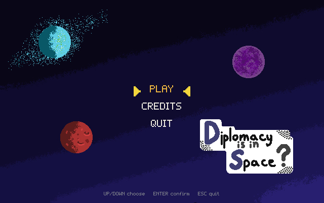 | 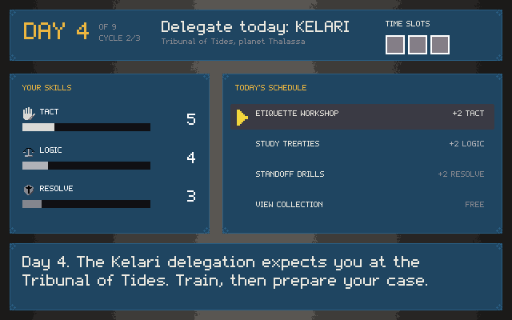 | 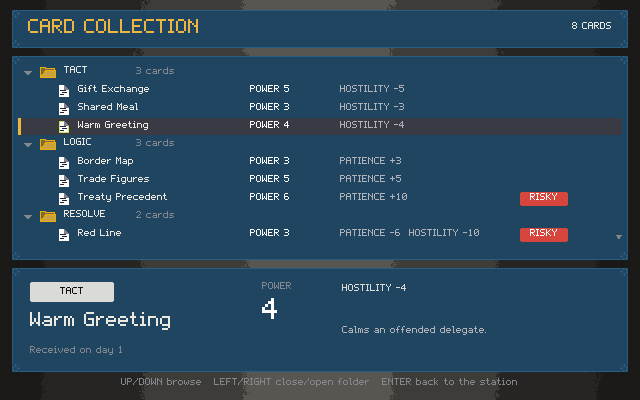 |

```sh
love .                    # menú principal -> PLAY (o CONTINUE si hay partida guardada)
love . negotiation        # solo una corte (Kelari), con reintento: para probar
love . map                # directo al mapa
love . --debug            # overlay de depuración sobre el juego
```

Con `--debug` aparece un panel sobre el juego: **F1** mostrar/ocultar, **F2/F3** escena, **F4/F5** entidad, **F6/F7** componente, **RePág/AvPág** campo, **-/=** editar el valor, **;/'** elegir y apagar un system, **F9** pausa, **F10** un frame.

**Controles:** flechas o WASD para moverte y elegir, ENTER para confirmar o jugar la carta, BACKSPACE para volver, ESC para salir.

---

# Entrega final

## La partida

Una partida son **9 días**, en **3 ciclos de 3**: en cada ciclo visitas a las tres delegaciones, siempre en el mismo orden (Kelari → Vorn → Ixili). Cada día:

```
Estación  →  Briefing  →  Mapa  →  Corte  →  Estación, día N+1
(entrenas)   (cartas)     vuelas al planeta   negocias con tu colección
```

**No hay reintento.** El resultado de cada corte queda registrado en el momento en que se decide (no al pulsar ENTER), así que cerrar el juego en la pantalla de resultado no sirve para repetir el día.

**La delegación recuerda cómo terminó la última vez** (solo la última reunión con *esa* delegación cuenta):

| Cómo terminó | La próxima vez que te sientas con ella |
|---|---|
| Paz | empieza normal |
| Walkout (se fue) | empieza con **3 menos de paciencia** (mínimo 4) |
| Guerra | empieza con **4 más de hostilidad** (máximo 14) |

El primer ciclo es más suave (más paciencia, menos hostilidad y delegados que se enojan más despacio), porque el operador aún tiene pocas cartas. Los números están en [`campaign.lua`](src/data/campaign.lua).

### Finales

| Final | Condición |
|---|---|
| **Win** — *Peace for the Concord* | los días **7, 8 y 9** terminan en paz |
| **Meh** — *An Uneasy Peace* | en los días 7, 8 y 9 hay alguien en guerra o que se fue |
| **Bad** — *The Concord Breaks* | las tres delegaciones de **un mismo ciclo** terminan en guerra (se decide al cerrar cada ciclo, y corta la partida ahí) |

| Win | Meh | Bad |
|---|---|---|
| 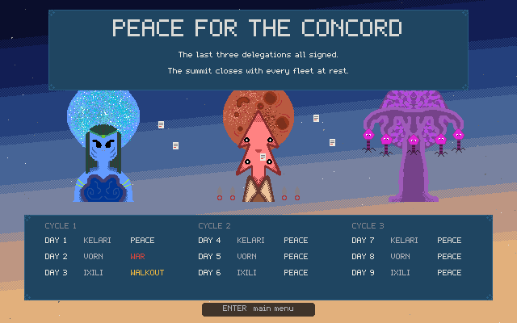 | 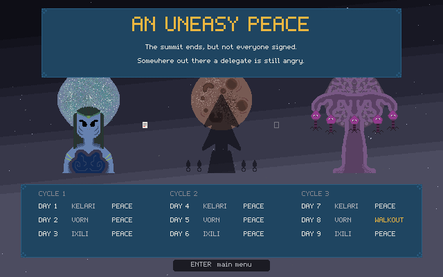 | 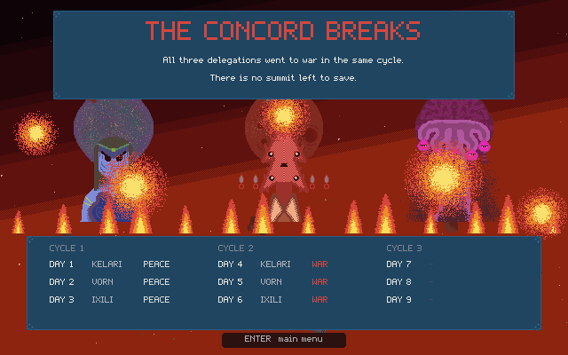 |

Las reglas viven en [`Campaign`](src/state/Campaign.lua) (módulo puro, sin LÖVE) y se prueban en [`tests/campaign.lua`](tests/campaign.lua). La pantalla de final es [`EndingScene`](src/scenes/EndingScene.lua).

## Mecánicas propias

### El delegado anuncia su jugada

Antes de cada ronda el delegado **anuncia qué va a hacer y cuánto como un rango** (no la cifra exacta, que se sortea al resolver). Jugar la carta del tipo correcto **suaviza el golpe** (se queda con el 25 %) y la mano marca esas cartas con `COUNTER`.

| Jugada | Qué hace | Rango | Se suaviza con |
|---|---|---|---|
| PRESS | sube la hostilidad | +2 a +4 | TACT |
| STALL | baja la paciencia | −1 a −3 | LOGIC |
| THREATEN | golpea las dos barras | 3 a 4 de cada una | RESOLVE |
| CALM | sube la paciencia | +1 | nada |

Cada delegación tiene **probabilidades distintas** de elegir cada jugada, y su **humor** (calma, cautela, tensión, furia) las dobla: un delegado furioso nunca se calma y amenaza el triple. Código: [`Intent`](src/negotiation/Intent.lua), [`Mood`](src/negotiation/Mood.lua), datos en [`intents.lua`](src/data/intents.lua).

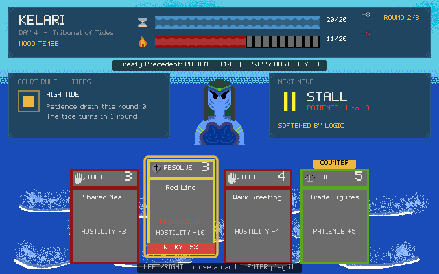

### Una regla distinta por corte

Cada corte dobla la ronda a su manera, sin que el resto del juego sepa de qué corte se trata ([`Modifiers`](src/negotiation/Modifiers.lua): un handler por id de regla):

| Corte | Regla |
|---|---|
| **Kelari** — Tribunal of Tides | la marea cambia cada 2 rondas: con marea alta la paciencia no baja al final de la ronda; con marea baja baja 2 |
| **Vorn** — Court of Blades | respetan la fuerza: RESOLVE +2 de poder, TACT −1 |
| **Ixili** — Assembly of Many | odian la repetición: un tipo distinto al de la ronda anterior da +1, el mismo −1 |

El panel de la izquierda muestra la regla del corte y su estado. Cada delegación también tiene su propio fondo y su propia animación por humor y por final.

| Court of Blades | Resultado |
|---|---|
| 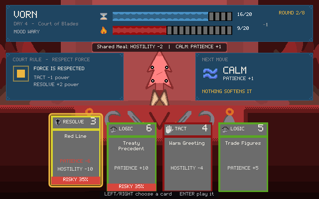 | 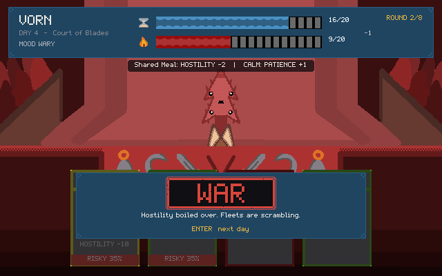 |

### Cartas riesgosas

El 20 % de las cartas generadas salen **riesgosas**: pegan el doble, pero con un **35 % de probabilidad se vuelven en tu contra** y suben la hostilidad en 8. Llevan una franja roja `RISKY`. Además, **ninguna carta mueve una barra más de 10 puntos de una vez**, sin importar su poder.

### Una ronda es una función pura

[`Round.play`](src/negotiation/Round.lua) recibe los datos de la negociación y la carta jugada y devuelve lo que pasó; el azar entra inyectado (`random()` → `[0,1)`, `random(lo, hi)` → entero), igual que en [`CardGenerator`](src/generation/CardGenerator.lua). Por eso [`tests/negotiation.lua`](tests/negotiation.lua) puede jugar miles de partidas simuladas sin abrir LÖVE y mostrar la tasa de paz de cada día (ver *Pruebas*). [`NegotiationSystem`](src/systems/NegotiationSystem.lua) solo traduce el evento `cardPlayRequested` a una llamada a `Round.play`.

## Guardado de partida

El guardado se hace **a mano, sin librerías**:

- [`Serializer`](src/state/Serializer.lua) convierte datos planos a JSON legible y de vuelta con un **parser propio**: nunca se usa `load()`, así que un archivo manipulado no puede ejecutar código.
- [`SaveGame`](src/state/SaveGame.lua) **valida cada campo** (día, slots, habilidades, cada carta, historial) y copia solo lo conocido a una tabla nueva: un archivo dañado o editado da «no hay partida», nunca un error. Antes de escribir, vuelve a leer el texto, así que un guardado malo no reemplaza a uno bueno. El almacenamiento se inyecta, y por eso se prueba sin LÖVE.
- [`AutosaveSystem`](src/systems/AutosaveSystem.lua) guarda al gastar un slot y al decidirse un día, y borra el guardado al llegar a un final. El menú muestra `CONTINUE  DAY N` solo si hay un guardado válido.

El archivo queda en la carpeta de guardado de LÖVE (`%APPDATA%\LOVE\diplomacy-is-in-space\save.json` en Windows). Pruebas: [`tests/save.lua`](tests/save.lua).

## Arte y assets

Todo el arte sale de Libresprite (fuentes en [`assets/src/`](assets/src/), PNG exportados en [`assets/sprites/`](assets/sprites/)).

- **Pipeline:** hojas horizontales (`Export Sprite Sheet → Horizontal Strip`). [`sprites.lua`](src/data/sprites.lua) declara el tamaño de cada una y [`Sprites`](src/graphics/Sprites.lua) las carga y dibuja. Si falta un PNG, cada `draw` devuelve `false` y el sistema que llamó sigue dibujando su forma plana; si el tamaño no coincide, el error dice cuál archivo y qué medida esperaba. Los paneles son **9-patch** (`ui_panel`).
- **Animaciones por estado:** cada delegado tiene un PNG por estado (`alien_<id>_calm|wary|tense|furious|peace|war|walkout`) con los frames que haga falta: el motor cuenta los frames por el ancho. Los humores se repiten en bucle y los finales se reproducen una vez ([`AlienRenderSystem`](src/systems/AlienRenderSystem.lua)). Si un estado no existe, se usa el del humor y luego el calmado.
- **Fuente propia:** el texto del juego usa una **fuente bitmap dibujada glifo a glifo** en [`font_main.lua`](src/data/font_main.lua) (letras de 5×7 en una celda de 9 px, con la separación por glifo), que [`Fonts`](src/graphics/Fonts.lua) convierte en una fuente de LÖVE a cualquier escala entera. No se usa ninguna fuente del sistema ni de internet.
- **Fondos:** [`BackgroundRenderSystem`](src/systems/BackgroundRenderSystem.lua) dibuja el fondo de la escena (menú, estación, cada corte, cada final) o, mientras no exista, el campo de estrellas.

## Cómo compilarlo

```sh
python tools/build.py                                  # build/DiplomacyIsInSpace.love
python tools/build.py --love C:/ruta/love-11.5-win64   # además una carpeta de Windows con el .exe
```

El `.love` lleva `main.lua`, `conf.lua`, `src/` y los PNG de `assets/sprites/` (sin pruebas ni fuentes de Libresprite).

## El motor

El juego corre sobre un ECS hecho a mano; no hay librerías externas.

- [`Registry`](src/ecs/Registry.lua): entidades con componentes en tablas; `spawn`, `add`, `get`, `destroy`, `query`, `each`, `first` y *resources* (datos únicos de la escena).
- [`Scene`](src/ecs/Scene.lua): una lista **ordenada** de systems; cada uno puede tener `setup`, `update(dt)`, `draw` y `unload`. El orden de la lista es el orden del frame.
- [`Game`](src/Game.lua): dueño de las escenas. Cambia de escena **entre frames** (los systems piden `switchRequest`) y convierte cada tecla en una entidad evento `keyPressed`, que vive un solo `update` y luego se barre.
- **Eventos como datos:** un system no llama a otro; spawnea una entidad con un componente de evento (`cardPlayRequested`, `negotiationChanged`, `dayEnded`, `packRequested`…) y los demás la leen en el mismo frame.
- **Estado compartido:** [`RunState`](src/state/RunState.lua) es una tabla de datos planos que sobrevive a los cambios de escena. Es lo único que se guarda.
- **Lógica pura aparte:** reglas como `Round`, `Campaign`, `CardEffect`, `CardGenerator`, `Collision` o `Serializer` no conocen LÖVE ni el registry, y se prueban con `lua` a secas.
- **Depuración:** [`DebugOverlay`](src/debug/DebugOverlay.lua) propio (inspector del registry, cambio de escena, pausa, apagar un system).

### Escenas

| Escena | Para qué sirve |
|---|---|
| `menu` | título, CONTINUE / PLAY / CREDITS / QUIT |
| `prep` | la estación: 3 slots de tiempo al día para entrenar habilidades |
| `collection` | el briefing: recibes el paquete del día y revisas la colección como un explorador de archivos |
| `map` | vuelas entre la estación y los mundos de las delegaciones |
| `negotiation` | la corte: la mano de cartas contra el delegado |
| `ending` | el final alcanzado y cómo salió cada uno de los 9 días |

Los systems de la negociación, en orden: [`HandInputSystem`](src/systems/HandInputSystem.lua) → [`OutcomeInputSystem`](src/systems/OutcomeInputSystem.lua) → [`NegotiationSystem`](src/systems/NegotiationSystem.lua) → [`RunProgressSystem`](src/systems/RunProgressSystem.lua) → [`AutosaveSystem`](src/systems/AutosaveSystem.lua) → [`HudSystem`](src/systems/HudSystem.lua) → render: fondo, [`AlienRenderSystem`](src/systems/AlienRenderSystem.lua), [`IntentRenderSystem`](src/systems/IntentRenderSystem.lua), [`HandRenderSystem`](src/systems/HandRenderSystem.lua), [`HudRenderSystem`](src/systems/HudRenderSystem.lua). `OutcomeInput` va antes que `Negotiation` para que la tecla que decide el resultado no pueda también descartarlo en el mismo frame.

## Pruebas

```sh
lua tests/campaign.lua      # días, ciclos, rencor entre cortes, los tres finales
lua tests/negotiation.lua   # jugadas, reglas de corte, rondas, cartas riesgosas, tope; simula 9 días
lua tests/save.lua          # serializador, guardado, archivos dañados o editados
lua tests/generation.lua    # la regla de generación de cartas
lua tests/run_state.lua     # el estado compartido es solo datos
lua tests/collision.lua     # colisiones del mapa
```

`tests/negotiation.lua` termina imprimiendo la **tasa de paz de 1000 partidas simuladas por día**, con un jugador al azar y uno que mira la jugada anunciada. Sirve para ajustar la dificultad con números en vez de a ojo.

## Estructura

```
main.lua                    bootstrap: registra escenas y reenvía callbacks
conf.lua                    ventana y carpeta de guardado
src/Game.lua                escenas, cambio diferido (switchRequest), keyPressed como evento
src/ecs/                    Registry + Scene (ECS propio)
src/scenes/                 Menu, Prep, Collection, Map, Negotiation, Ending
src/systems/                un archivo por system
src/negotiation/            Intent, Mood, Modifiers y Round (reglas puras de la negociación)
src/state/                  RunState, Campaign, Serializer y SaveGame (datos planos y reglas puras)
src/generation/             CardGenerator (regla pura de cartas)
src/world/                  TileGrid, Collision y Movement (lógica pura del mapa)
src/cards/                  CardEffect (regla pura) y CardRenderer (dibujo)
src/graphics/               Panel, Sprites y Fonts
src/data/                   paleta, delegaciones, jugadas, campaña, mapa, acciones, cartas, sprites, fuente
src/debug/                  debug overlay propio
assets/src/                 fuentes de Libresprite (.ase)
assets/sprites/             PNG exportados
tools/                      make_endings.py (finales y sellos) y build.py (compilar)
tests/                      pruebas en Lua puro
docs/img/                   capturas
```

---

# Entregas parciales

## Entrega 3 — Escena de mapa y exploración

*(Las capturas de esta sección son de la entrega 3: el mapa era de tiles planos. El arte de ahora se ve en la captura de abajo.)*

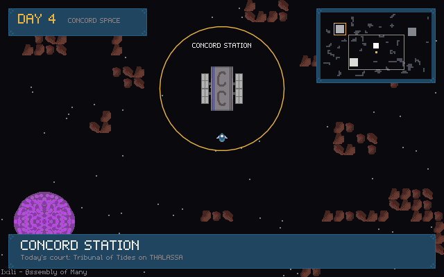

### Descripción

El mapa es **el sistema Concord**: el operador pilota un transbordador diplomático entre la estación y los mundos natales de cada delegación. Cada planeta es la sede del sistema judicial de su raza (los Kelari tienen el *Tribunal of Tides*, los Vorn la *Court of Blades*, los Ixili la *Assembly of Many*), así que viajar es ir al tribunal donde se negocia. Solo el planeta de la delegación del día está abierto; los demás dicen `CLOSED TODAY`.

### Diseño del mapa

El mapa es una cuadrícula de tiles escrita como texto: 80 × 48 celdas de 16 px (1280 × 768 px) en [`src/data/map.lua`](src/data/map.lua) (`.` espacio libre, `#` asteroide; los asteroides son grupos de celdas de formas irregulares). Es más grande que la pantalla (640 × 400), así que **la cámara sigue a la nave** y hay un minimapa para ubicarse. La estación (4×4 celdas) y los planetas (6×6) son bloques de celdas sólidas que se dibujan como un solo sprite ([`PoiRenderSystem`](src/systems/PoiRenderSystem.lua)); cada celda de asteroide elige una de 4 rocas según su posición ([`TilemapRenderSystem`](src/systems/TilemapRenderSystem.lua)). [`TileGrid`](src/world/TileGrid.lua) guarda el terreno de cada celda.

| Punto de interés | Dónde | Qué es |
|---|---|---|
| **Concord Station** | centro | Punto de partida; el HUD recuerda cuál es la corte de hoy |
| **Thalassa** (Kelari) | arriba a la izquierda | Tribunal of Tides (días 1, 4 y 7) |
| **Krag** (Vorn) | arriba a la derecha | Court of Blades (días 2, 5 y 8) |
| **Hexa** (Ixili) | abajo a la izquierda | Assembly of Many (días 3, 6 y 9) |

Hay 46 grupos de asteroides repartidos por el mapa, y la nave pasa entre ellos por pasillos angostos. Cada planeta lleva su nombre, raza y tribunal; el de la delegación de hoy se marca `[TODAY]`.

| Inicio, junto a la estación | Thalassa (planeta del día, abierto) | Krag (cerrado hoy) |
|---|---|---|
| 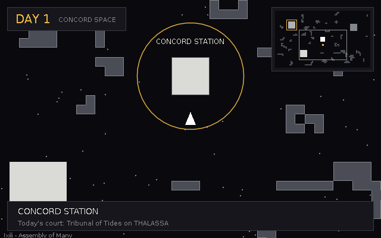 | 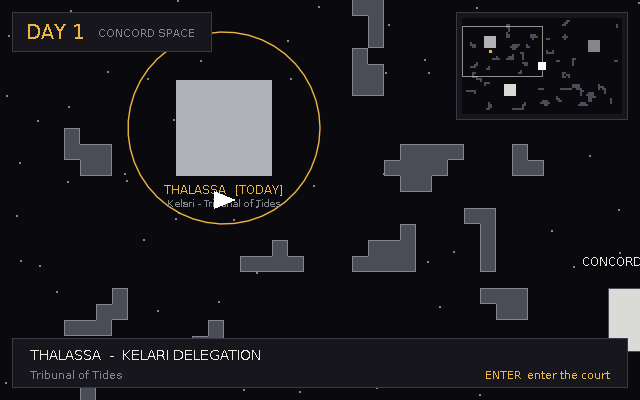 | 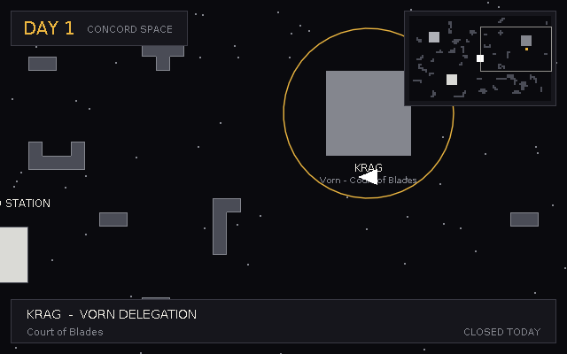 |

| La cámara sigue a la nave (el minimapa muestra la vista actual) |
|---|
| 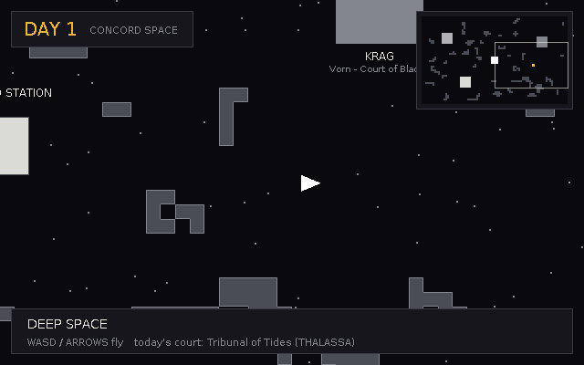 |

### Implementación

#### Setup → Update → Render

- **Setup**: [`MapScene`](src/scenes/MapScene.lua) crea una sola entidad `tilemap` (la cuadrícula, no una entidad por celda), una entidad por planeta/estación (`position`, `poi`) y la nave (`position`, `moveIntent`, `velocity`, `collider`, `ship`) en un punto libre junto a la estación, más los resources `map` (velocidad, lugar cercano) y `camera` (esquina superior izquierda de la vista).
- **Update** (el orden ES el orden del frame):

  | System | Responsabilidad |
  |---|---|
  | [`MapInputSystem`](src/systems/MapInputSystem.lua) | teclas sostenidas → `moveIntent`; ENTER → evento `interactRequested` |
  | [`MovementSystem`](src/systems/MovementSystem.lua) | `moveIntent` → `velocity` → `position` (px/s × `dt`, diagonal normalizada) |
  | [`TileCollisionSystem`](src/systems/TileCollisionSystem.lua) | saca a la nave de las celdas sólidas |
  | [`MapBoundsSystem`](src/systems/MapBoundsSystem.lua) | mantiene la nave dentro del mapa |
  | [`ShipFacingSystem`](src/systems/ShipFacingSystem.lua) | rumbo de la nave y si el motor está encendido |
  | [`CameraSystem`](src/systems/CameraSystem.lua) | la vista sigue a la nave y se detiene en los bordes del mundo |
  | [`ProximitySystem`](src/systems/ProximitySystem.lua) | qué lugar tiene la nave cerca → `map.nearby` |
  | [`CourtEntrySystem`](src/systems/CourtEntrySystem.lua) | ENTER junto al planeta del día → cambio a la corte |

- **Render**: fondo de estrellas con parallax ([`StarfieldRenderSystem`](src/systems/StarfieldRenderSystem.lua)) → [`CameraBeginSystem`](src/systems/CameraBeginSystem.lua) → **mundo**: [`TilemapRenderSystem`](src/systems/TilemapRenderSystem.lua) (solo las celdas visibles), [`PoiRenderSystem`](src/systems/PoiRenderSystem.lua) (estación y planetas, anillo de cercanía, nombres), [`ShipRenderSystem`](src/systems/ShipRenderSystem.lua) → [`CameraEndSystem`](src/systems/CameraEndSystem.lua) → **pantalla**: [`MapHudRenderSystem`](src/systems/MapHudRenderSystem.lua) (día, lugar cercano y qué hacer ahí) y [`MinimapRenderSystem`](src/systems/MinimapRenderSystem.lua). Los dos systems de cámara solo abren y cierran `push/translate/pop`: en la lista se ve qué es mundo y qué es UI, y por eso el HUD no se mueve con la cámara.

#### Movimiento
Input continuo con `love.keyboard.isDown` (WASD / flechas), porque una tecla mantenida no cabe en un evento `keyPressed`. Velocidad en px/s integrada con `dt` (170 px/s). [`Movement`](src/world/Movement.lua) (módulo puro) normaliza la diagonal y decide el rumbo por eje dominante.

#### Límites
`MapBoundsSystem` recorta la posición al rectángulo del mundo, con la mitad del hitbox de la nave de margen. La cámara también se recorta, así que nunca muestra nada fuera del mapa.

#### Colisiones
Una celda vacía es `nil` y cualquier terreno es sólido. [`Collision`](src/world/Collision.lua) (funciones puras) revisa las celdas que toca el hitbox de la nave y resuelve **eje por eje**, así que la nave *se desliza* por una pared en vez de pegarse. Asteroides, estación y planetas son celdas, por lo que una sola regla cubre todo. Demostrado en [`tests/collision.lua`](tests/collision.lua).

| Colisión con un asteroide | Límite del mapa (borde izquierdo) |
|---|---|
| 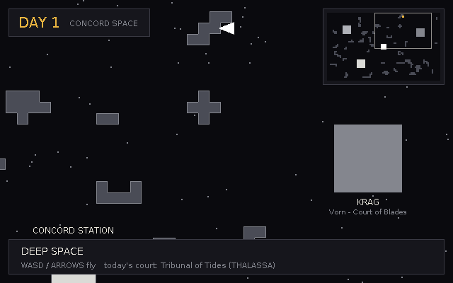 | 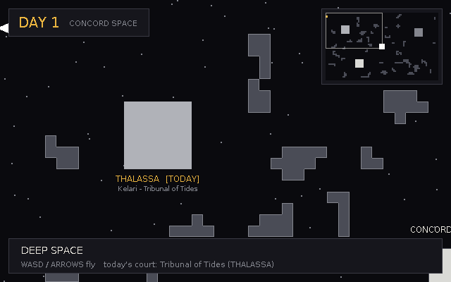 |

#### Puntos de interés
Cada uno es una entidad con `poi` (id, tipo, nombre, radio y rango). `ProximitySystem` calcula un único dato (`map.nearby`) que consumen el HUD, el anillo de acento y la entrada a la corte; así nadie mide distancias por su cuenta.

#### Transición hacia / desde la escena
- **Entrar**: en el briefing, ENTER → `switchRequest` a `map` ([`CollectionExitSystem`](src/systems/CollectionExitSystem.lua)). También `love . map`.
- **Salir**: volar al planeta de la delegación del día y ENTER → [`CourtEntrySystem`](src/systems/CourtEntrySystem.lua) cambia a la corte. Al terminarla, el resultado se registra y ENTER pasa al día siguiente (o al final). El estado (`RunState`) es compartido, así que colección y habilidades siguen ahí.

#### Código fuente
Escena [`MapScene`](src/scenes/MapScene.lua) · datos [`map.lua`](src/data/map.lua) · lógica pura [`TileGrid`](src/world/TileGrid.lua), [`Collision`](src/world/Collision.lua), [`Movement`](src/world/Movement.lua) · pruebas [`tests/collision.lua`](tests/collision.lua) · systems en [`src/systems/`](src/systems/).

## Entrega 2 — ciclo de progresión

Estación (3 acciones al día → habilidades), briefing (un paquete de cartas generado desde las habilidades), colección persistente, `RunState` compartido y la corte como cierre del día. Regla de generación en [`CardGenerator`](src/generation/CardGenerator.lua) (la probabilidad de cada tipo es proporcional a su habilidad y el poder se sortea entre el 50 % y el 100 % de ella). Capturas en `docs/img/e2-*.png`.

## Entrega 1 — UI

Menú principal, HUD de negociación (paciencia / hostilidad) y mano de cartas, con Setup → Update → Render cada uno. Capturas en `docs/img/e1-*.png`.
